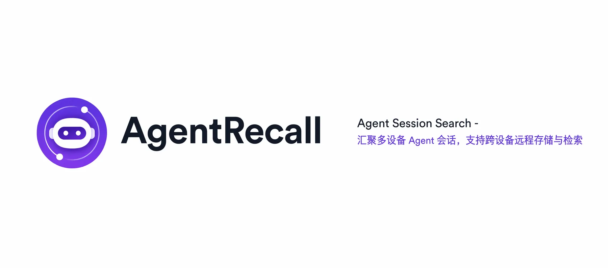
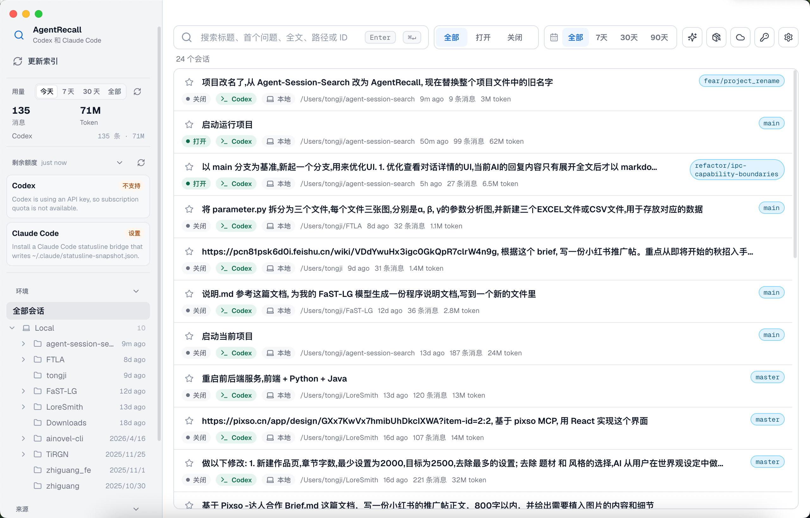

<p align="center">
  
</p>

<h1 align="center">AgentRecall</h1>

<p align="center">本地桌面工具 · 搜索、查看、恢复 AI Coding Agent 会话</p>

<p align="center">
  简体中文 ｜ <a href="./docs/README.en.md">English</a>
</p>

<p align="center">
  
  
  
  
  <a href="https://github.com/zszz3/AgentRecall/stargazers"></a>
  <a href="./LICENSE"></a>
</p>

<p align="center">
  
</p>

AgentRecall 用来集中管理分散在不同 AI Coding Agent 中的会话，并在同一套本地工作台里提供会话轨迹与上下文分析、本地模型网关、灵动岛提醒、Skills 库、MCP Gateway、Eval、Memory 经验卡与团队协作能力。

## 核心功能

- **工作台与会话管理**：统一索引 Claude Code、Codex、DeepSeek Harness、Gemini CLI、Pi、ZCode 以及可选的 CodeBuddy、WorkBuddy、CodeWiz、Cursor Agent、OpenCode、Hermes、OpenClaw、WSL、SSH 等来源；支持按轮次查看轨迹与上下文曲线、全文与 AI 检索、Resume、跨 Agent 迁移、导出和 Supabase 云端恢复。
- **本地模型网关**：可选内置本机网关（默认 `127.0.0.1:4325`，默认关闭），支持 OpenAI Chat / Responses 与 Anthropic Messages 协议互转、多上游 Fallback、实时请求记录，以及为常见编码 Agent 一键接入与无损还原。
- **顶部灵动岛提醒**：支持桌面与终端 Agent 的实时状态提醒与一键直达轨迹（默认关闭，可在 **设置 → 外观** 中开启）。
- **Skills 与指令**：统一管理本机已启用、托管 Skill 库和团队 / 云端 Skills，支持一键分发到各 Agent 并检测冲突；只读预览本机与项目级 `AGENTS.md` / `CLAUDE.md` 等指令文件。
- **MCP Gateway**：为 Codex 与 Claude Code 提供统一的 `agent-recall` MCP 入口，内置会话与 Skill 检索并按需代理外部 STDIO / HTTP MCP 服务。
- **Runtime、Agent、Eval 与经验卡**：配置可复用 Agent 与 Skill 回归评测闭环，开启后自动从会话提炼项目经验卡。
- **团队空间与统一 CLI**：按团队管理共享会话、Skills 与文档，支持 Push 清单 Diff 审核与 Pull 冲突保护；随主包内置 `agent-recall` / `agentrecall` 统一 CLI，可在无窗口模式下配置团队、诊断环境与检索本地会话。

## 安装与启动

准备 **Node.js 22.13+**，安装最新的 Release：

```bash
npm install -g https://github.com/zszz3/AgentRecall/releases/latest/download/agent-recall.tgz --registry=https://registry.npmjs.org/
agent-recall
```

| 系统 | 启动命令 | 默认快捷键 |
| --- | --- | --- |
| macOS | `agent-recall` | `⌥ Option + Space` |
| Windows | `agent-recall` | `Ctrl + Alt + Space` |

启动后应用常驻菜单栏或系统托盘，并自动准备内置 PostgreSQL 数据服务。macOS 上执行 `agent-recall install-app` 可生成本地 `AgentRecall.app`，从 Launchpad / Spotlight / Dock 直接打开。更新执行 `agent-recall --update` 即可，App 内也可在 **设置 → 关于** 检查更新。

从 V1 升级不会覆盖原有的 SQLite 数据，可在 **设置 → 关于 → V1 数据迁移** 中手动导入；从旧版 `agent-recall-v2` 升级会自动沿用现有数据。完整的安装、更新、回滚、卸载与排障说明见 [Install.md](./Install.md)，详细使用说明见 [使用指南](./docs/v2/guide.md)。

## 本地与团队

AgentRecall 提供独立的[团队空间](docs/v2/team-workspace.md)，按团队集中管理共享会话、Skills 与文档，并为多个工作目录分别选择客户端和启停状态。团队功能默认关闭，连接与开关在设置中管理，与 CLI 共用配置。

## 统一 CLI

安装 `agent-recall` 后即同时提供 `agent-recall` 与 `agentrecall` 两个等价命令，除启动与更新桌面端外，支持无窗口本机会话检索、环境诊断（`doctor`）、团队资产仓库初始化与工作目录同步。命令清单与配置契约见 [CLI 使用指南](./docs/v2/cli.md)，团队资产流程见 [团队 Skill 指南](./docs/v2/team-assets.md)。

## 隐私与安全

- 会话索引与元数据保存在本机，不经过 AgentRecall 提供的第三方服务。
- 各 Agent 的原始会话文件只作为读取来源；恢复和迁移会创建新副本。
- 跨设备同步完全可选，使用你自己的 Supabase 项目。
- AI 摘要、AI 搜索和自动记忆会把相关内容交给你选择的 Provider；是否启用由你决定。
- AgentRecall 不收集遥测或使用数据，项目代码公开在本仓库。

## 参与贡献

欢迎提交 Issue 和 PR。本地开发：

```bash
git clone https://github.com/zszz3/AgentRecall.git
cd AgentRecall
npm run setup
npm run dev
```

Windows 上首次执行 `npm run setup` 需要以管理员身份运行终端，以便准备内置 PostgreSQL 所需的符号链接。桌面应用位于 `apps/main-2.0`，根目录命令负责统一安装、测试、类型检查和构建。

提交前请阅读 [CONTRIBUTING.md](./CONTRIBUTING.md)，并确保 `npm test`、`npm run typecheck` 与 `npm run release-note:check` 通过。

### Collaborators

<!-- readme: collaborators -start -->
<table>
	<tbody>
		<tr>
            <td align="center">
                <a href="https://github.com/Blue-Berrys">
                    
                    <br />
                    <sub><b>Blue-Berrys</b></sub>
                </a>
            </td>
            <td align="center">
                <a href="https://github.com/G-Pegasus">
                    
                    <br />
                    <sub><b>G-Pegasus</b></sub>
                </a>
            </td>
            <td align="center">
                <a href="https://github.com/zszz3">
                    
                    <br />
                    <sub><b>zszz3</b></sub>
                </a>
            </td>
            <td align="center">
                <a href="https://github.com/mesakurax">
                    
                    <br />
                    <sub><b>mesakurax</b></sub>
                </a>
            </td>
            <td align="center">
                <a href="https://github.com/LANSGANBS">
                    
                    <br />
                    <sub><b>LANSGANBS</b></sub>
                </a>
            </td>
            <td align="center">
                <a href="https://github.com/forbbiden1">
                    
                    <br />
                    <sub><b>forbbiden1</b></sub>
                </a>
            </td>
		</tr>
		<tr>
            <td align="center">
                <a href="https://github.com/MeloMei">
                    
                    <br />
                    <sub><b>MeloMei</b></sub>
                </a>
            </td>
		</tr>
	<tbody>
</table>
<!-- readme: collaborators -end -->

## 开源协议

本项目基于 [MIT License](./LICENSE) 开源。

> [!NOTE]
> AgentRecall 是独立的开源项目，与 Anthropic、OpenAI、Cursor 等公司均无关联。Claude、Codex 等名称与商标归其各自所有者所有。

有任何问题，请提交 Issue。如果觉得项目对你有帮助，欢迎 Star。

## 开发文档

[文档入口](docs/README.md) · [功能规格](docs/spec/README.md) · [架构决策](docs/adr/README.md) · [贡献指南](CONTRIBUTING.md)
