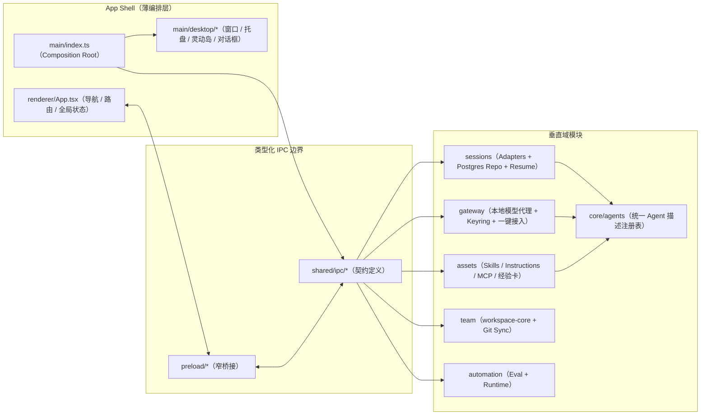

# AgentRecall 2.0 桌面端模块化架构重构设计

- **状态**：部分实施（Phase 1 入口拆解与自动化边界守卫已落地，见 [ADR 0030](../adr/0030-modular-desktop-architecture-and-guardrails.md)；Phase 2–5 规划中）
- **日期**：2026-11-25

> 本文记录对 `apps/main-2.0` 的架构体检、目标分层与分阶段演进路线。约束前提：保持 [ADR 0003](../adr/0003-electron-operation-ownership.md)（主进程持有特权操作）与 [ADR 0027](../adr/0027-unified-v2-product.md)（磁盘数据兼容锚点）不被打破。

---

## 1. 重构前架构体检

重构前对 `apps/main-2.0/src` 非测试代码的盘点暴露出 5 个结构性病灶：

1. **巨石入口文件集中**：
   - `src/main/index.ts`（重构前 3,126 行）：37 个模块级可变 `let` 与 21 处散落 `ipcMain.handle/on`，混合窗口、托盘、灵动岛、快捷键、设置、SSH、导出与 Automation 编排。
   - `src/renderer/src/App.tsx`（重构前 1,717 行）：同时承担全局外壳路由与 Session 页面全部交互状态及弹窗。
   - `src/core/platform.ts`（重构前 1,745 行）：将应用设置 Schema、Shell 转义、终端拉起、文件管理器定位、迁移 CLI 探测与 Resume 命令混为一体。
   - `src/core/session-loaders/alternative-sources.ts`（3,355 行）+ `src/core/session-loader.ts`（2,333 行）与 `src/core/postgres/schema.ts`（2,268 行）+ `session-repository.ts`（2,274 行）。
2. **Agent 元数据散落多处**：同一个 Coding Agent 的路径、图标与能力配置分散在会话来源、Skill 注册表、指令文件、MCP 配置、模型网关和灵动岛监听中，新增 Agent 需改动 8–10 处。
3. **`src/automation/engine/` 平行子应用**：内嵌引擎与主应用维护两套 UI 原语与多层样式。
4. **多层 CSS 叠加**：历史页面 CSS、`automation-upstream` 样式与 Tailwind v4 / Studio tokens 长期并存。
5. **IPC 契约多处手工同步**：`src/shared/ipc/*`、`src/main/ipc/*`、`src/preload/*` 与渲染器类型分散维护。

---

## 2. 目标分层与垂直域架构

---

## 3. 分阶段演进路线与落地状态

| 阶段 | 核心动作 | 当前状态 | 关键文件 / 守卫 |
| --- | --- | --- | --- |
| **Phase 1：拆三大巨石 + 架构守卫** | 拆 `src/core/platform.ts` 为 6 个子模块；`src/main/index.ts` 抽出 `main/desktop/*`、`main/ipc/core-ipc.ts` 与核心服务；`App.tsx` 下沉 `features/app/*` 与 `features/sessions/*`；新增边界与行数上限测试 | **已实施**（见 [ADR 0030](../adr/0030-modular-desktop-architecture-and-guardrails.md)） | [architecture-boundaries.test.mjs](../../apps/main-2.0/scripts/architecture-boundaries.test.mjs)、[check-source-entrypoints.mjs](../../apps/main-2.0/scripts/check-source-entrypoints.mjs) |
| **Phase 2：统一 Agent 注册表 + Loader 插件化** | 建立统一 `AgentDescriptor` 事实源；将 `alternative-sources.ts` 与 `session-loader.ts` 拆为按 Agent 独立的 `SessionSourceAdapter` | 规划中 | `src/core/agent-skill-registry.ts`、`src/core/session-loaders/` |
| **Phase 3：Postgres 迁移与仓储拆仓** | `schema.ts` 拆分为编号迁移模块；`session-repository.ts` 按写/查/统计/元数据职责拆分 | 规划中 | `src/core/postgres/` |
| **Phase 4：IPC 单真源 + Provider 收敛** | 引入统一 `IpcInvokeMap` 生成 main/preload/renderer 契约；收敛历史 `provider-service.ts` 兼容层至 `ModelGatewayService` | 规划中 | `src/shared/ipc/`、`src/preload/` |
| **Phase 5：收敛 `automation/engine` 与 CSS 瘦身** | 逐步将 MCP / Runtime / Eval 页面对齐统一 `ui/catalog` + `ui/primitives`，清理历史 `automation-upstream` 与冗余页面 CSS | 规划中 | `src/renderer/src/ui/`、`src/automation/` |

---

## 4. 自动化架构守卫（已生效）

由 [architecture-boundaries.test.mjs](../../apps/main-2.0/scripts/architecture-boundaries.test.mjs) 持续校验：

1. **禁止跨层反向依赖**：`src/core/` 不得导入 `electron`、`src/main/`、`src/renderer/`；`src/renderer/` 不得导入 `electron`、`src/main/`、`node:*`。
2. **禁止 IPC 回流入口**：`src/main/index.ts` 中 `ipcMain.handle` / `ipcMain.on` 直接调用数必须为 `0`。
3. **入口行数预算**：`src/core/platform.ts` ≤ 80 行、`src/main/index.ts` ≤ 1,100 行、`src/renderer/src/App.tsx` ≤ 900 行。
4. **死代码可达性**：[check-source-entrypoints.mjs](../../apps/main-2.0/scripts/check-source-entrypoints.mjs) 校验全部生产源码从声明入口可达。
