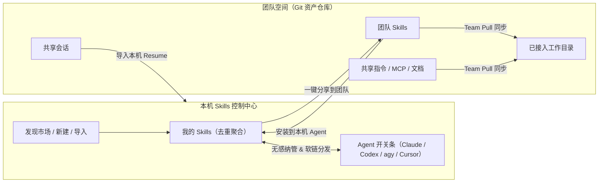

# 团队空间精简与 Skills 控制中心重塑设计

- **状态**：已实施（核心架构与兼容边界见 [ADR 0028](../adr/0028-streamlined-team-space-and-skills.md)，当前行为见 [团队资产规格](../spec/team-assets.md) 与 [Skills 规格](../spec/skills.md)）
- **日期**：2026-11-25

> **核心定位**：AgentRecall 不是重造 Git 客户端或文档库，而是让个人与团队在多个 Coding Agent（Claude Code、Codex、Antigravity / `agy`、Cursor 等）之间无缝共享「可执行的经验与配置」。

---

## 1. 现状痛点

### Skills 页痛点
- **“入库 vs 安装”概念割裂**：旧版将本机发现、托管库、团队与云端强拆成竞争心智的入口；从本机目录点击「加入 Skill 库」仅复制文件而不平滑接管原路径，导致目标 Agent 立刻出现红色「冲突」。
- **目标覆盖陈旧且噪音高**：平铺所有硬编码 Agent（含本机未安装的客户端），同时缺少 `Antigravity (agy)` 与 `Cursor`。
- **缺少创作与团队闭环**：只读单文件预览，无法浏览多文件 Skill 包（`scripts/`、`references/`）、新建/编辑 Skill，也不能一键分享到团队；同名 Skill 在多个目录与项目路径下容易重复列出。

### 团队空间痛点
- **11 个平铺标签页过重**：`Agent 角色`、`运行成果`、`Env`、`成员与动态`、`审核规则` 与 8 层虚拟文件夹分散了真正高频的团队共享心智。
- **配置与同步入口割裂**：建团队、绑工作目录、查看同步状态散落在设置页与主内容区，界面仍沿用早期 `<pre>` / `<select>` / `<details>` 原型控件。

---

## 2. Skills 控制中心设计

### 顶层视图（3 视图）
1. **我的 Skills**（默认）：统一展示本机托管库、各 Agent 用户目录与项目级 Skill，支持按状态（`全部 / 已启用 / 未启用 / 项目级`）与 Agent 轻筛选。
2. **团队 Skills**：接入团队后直接展示渲染后的 Markdown 与文件列表，支持一键安装到本机 Agent。
3. **发现市场**：内嵌全页浏览 `skills.sh` 榜单、关键词检索与 AI 探索，顶部提供「新建 Skill」与「本地导入」。

> 个人 Supabase 云端同步退回设置与详情页「更多操作」，仅在用户已配置或显式启用时展示。

### 关键交互设计
1. **无感纳管（Auto-Adopt）**：对本机用户级未托管 Skill 点击任意 Agent 开关时，先导入托管库并校验内容哈希一致，再把原路径平滑替换为托管软链并同步目标 Agent，一次点击消除「先入库即冲突」。
2. **智能 Agent 开关条**：在 [agent-skill-registry.ts](../../apps/main-2.0/src/core/agent-skill-registry.ts) 中补齐 `Antigravity (agy)` 与 `Cursor`，按本机检测结果优先展示常用已装 Agent，其余折叠至 `+ 更多`。
3. **跨来源去重**：聚合托管库、用户目录、软链与多项目目录中的同名 Skill 为单条记录（托管库优先），并在元数据中展示全部生效位置。
4. **多文件包预览与折叠**：支持在正文上方切换查看 `SKILL.md` 及附属文件；当单包文件数量较大时默认折叠为带筛选的抽屉，避免挤压阅读区。
5. **创作与团队共享闭环**：支持新建规范 frontmatter Skill、内联编辑、外部编辑器打开与一键「分享到团队」。

---

## 3. 团队空间瘦身设计

### 标签收敛（11 标签 → 5 核心标签 + 顶栏工作目录弹窗）

```text
旧版（11 个平铺 Tab）：
[共享会话] [Agent 角色] [运行成果] [Skills] [文档] [共享指令] [MCP] [Env] [工作目录] [成员与动态] [审核规则]

新版（5 个核心 Tab + 顶部工作区控件）：
左侧团队切换器 ▾  |  [ 共享会话 ] [ Skills ] [ 共享指令 ] [ MCP ] [ 文档 ]  |  [ 工作目录 ] [ 拉取更新 ] [ 发布变更 ]
```

| 模块 | 决策 | 兼容说明 |
| --- | --- | --- |
| 共享会话 / Skills / 共享指令 / MCP / 文档 | 保留并对齐 Studio 视觉、Markdown 与结构化详情预览 | 完全保留现有 Git 与 Release 协议 |
| 工作目录接入与启停 | 移入顶栏「工作目录」弹窗 | 不打断当前浏览上下文 |
| Agent 角色 / 运行成果 / Env / 成员与动态 / 审核规则 / 虚拟文件夹 | 从桌面端 UI 下线 | `workspace-core` 与主进程继续保持清单版本 1–6、`OWNERS.json` 推送审核分流与旧目录角色筛选的静默读兼容 |

---

## 4. Skills × 团队空间协同流


