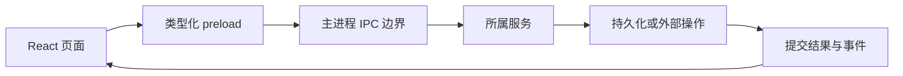

# 应用架构与数据边界

范围：当前仓库的统一桌面与 CLI 应用（`apps/main-2.0`）以及共享核心 `packages/workspace-core`。本文给出跨模块阅读入口；业务契约由各领域规格维护，发布与安装命令见 [贡献指南](../../CONTRIBUTING.md)。

## 产品和部署单元

| 单元 | 职责 | 数据边界 |
| --- | --- | --- |
| AgentRecall 桌面端（`apps/main-2.0`） | 会话索引与轨迹、本地模型网关、灵动岛、Runtime、Agent、Eval、Skill 库与团队空间 | PostgreSQL（`<appData>/agent-recall-v2`）；不隐式导入遗留 V1 SQLite 数据 |
| 统一 CLI（`apps/main-2.0/src/cli` + `bin/agent-recall.cjs`） | 随主包提供 `agent-recall` / `agentrecall` 命令：桌面启动与更新、环境诊断、团队配置与资产同步、以及会话/资源检索 | 资产与配置通过 `workspace-core` 读写 `~/.agentrecall-cli`；本机会话检索优先桌面桥接并支持进程内回退至无窗口搜索后台 |
| `packages/workspace-core` | 团队配置、Git 资产、安装归属和分发 | 不依赖 Electron；由统一 CLI 与桌面主进程共同调用 |

架构演进见 [ADR 0027](../adr/0027-unified-v2-product.md) 与 [ADR 0029](../adr/0029-unified-cli-in-main-package.md)。

## 一次桌面操作的路径

这张图是所有权图，不表示所有旧接口已经统一迁入同一套注册器。当前仍有历史 IPC；新增或修改接口时应核对实际调用链。

- Renderer 持有筛选、选中、展开、编辑草稿等交互状态，不直接读取本机文件、凭据或启动进程。
- Preload 提供窄桥接；跨边界输入由主进程的契约或所属服务验证。
- Main 持有窗口、原生对话框、服务生命周期和 IPC 注册；业务规则放所属服务或 core。
- Core 持有源格式、持久化和领域规则；`core` 并不意味着浏览器安全，不能从 renderer 任意导入其中的 Node 模块。
- Automation 持有 V2 执行编排。运行配置、调用记录和 Eval Run 各有独立身份。

## 数据的权威来源

| 数据 | 权威来源 | 不能据此推断的事情 |
| --- | --- | --- |
| 编码 Agent 历史 | 源文件及可还原的持久化索引 | 页面截断不代表原文已截断 |
| 团队 Git 资产 | 已发布提交和清单 | 本地缓存存在不代表远端没变化 |
| 本地团队副本 | 文件实际内容及归属记录共同校验 | 同名、同内容不代表 AgentRecall 拥有覆盖权限 |
| Runtime 调用 | invocation 及后端实际报告的引用 | 请求里填了 sessionId 不代表后端真的续接 |
| Eval 结果 | 实验执行记录、各项判断和证据覆盖 | 判断器失败不能解释为 Agent 得零分 |
| 经验卡 | 来源会话与轮次范围（卡片是模型派生内容） | 卡片存在不代表做法仍然正确；有冲突时以来源原文为准 |

## 跨模块关系

会话索引为页面搜索、MCP 和 Eval 提供历史读取。Runtime 返回的原生会话引用用于关联索引，不能凭展示标题猜测对应关系。Skill 库可以提供执行指令和回归评估输入；导入 Skill 不等于安装到客户端。团队资产 Pull 会写客户端文件，但不替客户端执行或加载它们。

这些关系通过明确接口连接，不应通过读取其他模块私有表、拼接其内部目录或复制缓存实现。

## 故障与生命周期

窗口关闭、页面离开、服务停止和应用退出不是同一种取消。页面离开主要停止后续 UI 消费；主进程服务可能仍拥有合法运行中的任务。窗口绑定的团队上传预览需要清理，后台 Eval 则由 Eval 服务持有并在关闭时等待退出。

任一跨系统流程都应分别报告本地持久化、远端提交和后续刷新。不能把缓存失败反报成远端发布失败，也不能把子进程启动反报成任务完成。

## 修改影响检查

| 改动 | 至少追踪到哪里 |
| --- | --- |
| 新增 IPC 字段 | 共享类型/校验、handler、preload、renderer、边界测试 |
| 新增会话来源 | loader、身份与文件状态、store、来源能力和两版差异 |
| 新增 Runtime 驱动 | 能力、路由、状态 codec、调用记录、取消与关闭 |
| 新增团队资源 | 清单版本、快照、Diff、发布、安装归属、退役与兼容 |
| 修改持久化格式 | 旧记录读取、升级/拒绝、失败恢复和合成数据测试 |

## 验证入口

[会话索引](session-indexing.md)、[团队资产](team-assets.md)、[Runtime](runtime.md)、[Eval](evaluation.md)、[MCP](mcp.md)、[Skills](skills.md)、[经验卡](memory.md)、[桌面生命周期](desktop-lifecycle.md)各自列出验收场景和实现入口。

本文不保证每个模块已经具备端到端覆盖；测试文件存在、定向测试通过、真实桌面验收和正式发布是不同证据。

## V2 界面控件

主窗口通过 `apps/main-2.0/src/renderer/src/app-styles.css` 加载样式。`pages` 层保留各页布局，后置的 `controls` 层统一输入框、下拉框、文本域、操作按钮和分段选项的外观。新增页面沿用 `styles/controls.css` 的控件规则与主题变量，不再单独定义一套高度、圆角和焦点颜色。

普通输入框为 36px，操作按钮为 32px；画布与分页等紧凑位置通过 `--field-height` 调整尺寸。搜索栏由外层提供背景和焦点环，内部输入框保持透明；文本域保留多行高度，开关保留其开关形状，导航项与可点击列表行不套用操作按钮尺寸。主操作、次要操作与危险操作分别使用强调色、中性背景和危险色，禁用态与键盘焦点随主题变化。独立的全局快速搜索窗口保留其浮窗布局。

前端组件测试位于 `apps/main-2.0/src/renderer/src`。视觉验收需在实际窗口检查各页表单、搜索筛选、弹窗、焦点和禁用态，同时复核深浅主题。
